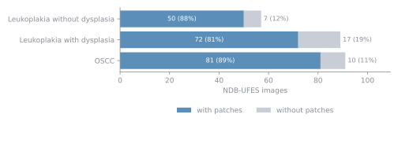
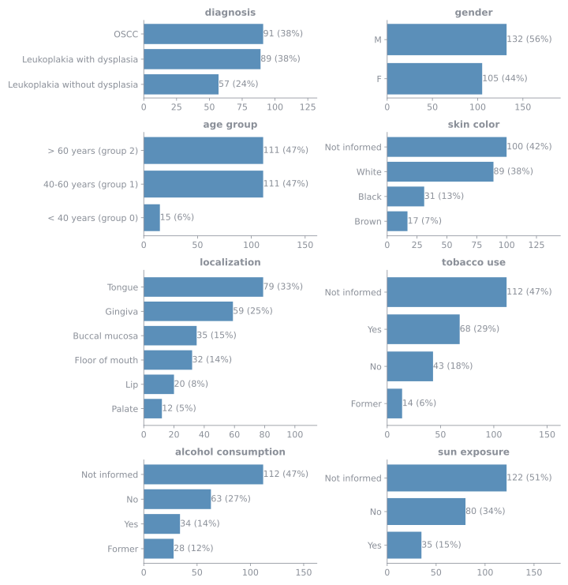
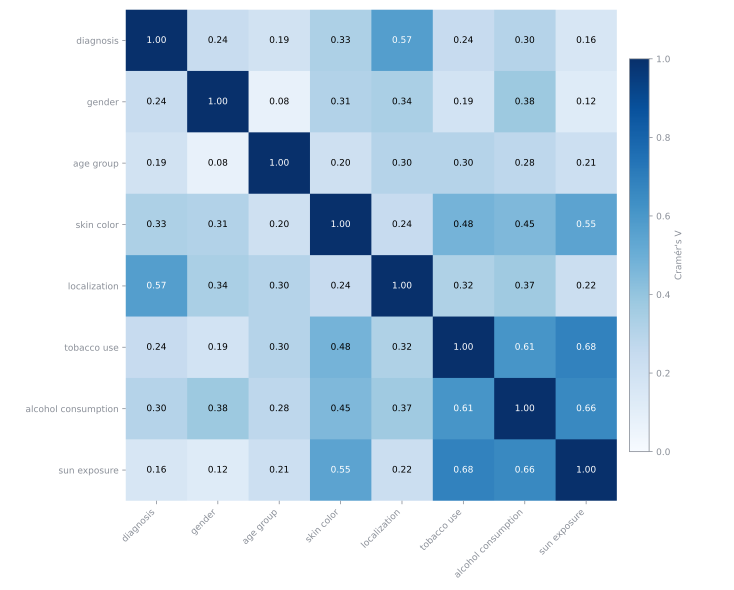

# Factsheet: NDB-UFES

NDB-UFES, the public dataset of whole histopathology images with patient data and a diagnosis for each image, counted from its metadata file. The patches cut from these images are described in the [P-NDB-UFES factsheet](factsheet-p-ndb-ufes.md). Every number on this page comes from the published tables.

## At a glance

| Item | Count |
| --- | ---: |
| Images | 237 |
| Patients | 69 |
| Lesions | 77 |
| Images with patches in P-NDB-UFES | 203 |
| Images without patches | 34 |

Of the 34 images without patches, 14 are also in SAB but were never cut into usable patches, and 20 exist only in NDB-UFES. See [About the Data](about-the-data.md).

## Columns of the metadata

The metadata file has one row per image. The meanings are those of the dictionary that comes with the dataset. The values are listed when a column has 8 or fewer, and `Filled` is how many of the 237 images have a value.

| Column | Meaning | Values | Filled |
| --- | --- | --- | ---: |
| `public_id` | A unique ID for each sample, which is one image. | 237 distinct | 237 |
| `lesion_id` | The lesion the image shows. One lesion can have several images. | 77 distinct | 237 |
| `patient_id` | The patient. One patient can have several lesions and images. | 69 distinct | 237 |
| `path` | Histopathologic image filename. | 237 distinct | 237 |
| `localization` | Lesion's localization in the body. | Buccal mucosa, Floor of mouth, Gingiva, Lip, Palate, Tongue | 237 |
| `larger_size` | Larger size of the lesion, in centimeters. The dictionary does not say what the value 0 means. | 20 distinct | 237 |
| `tobacco_use` | Patient's tobacco use. | Former, No, Not informed, Yes | 237 |
| `alcohol_consumption` | Patient's alcohol consumption. | Former, No, Not informed, Yes | 237 |
| `sun_exposure` | Patient's sun exposure. The original dictionary describes it in hours, with -1 when not informed, but the metadata file holds the values listed here. | No, Not informed, Yes | 237 |
| `gender` | Patient's gender: male or female. | F, M | 237 |
| `skin_color` | Patient's skin color. | Black, Brown, Not informed, White | 237 |
| `age_group` | Patient's age group: group 0 is under 40 years, group 1 is 41 to 60 years, included, and group 2 is over 60 years. | 0, 1, 2 | 237 |
| `diagnosis` | Lesion diagnosis. | Leukoplakia with dysplasia, Leukoplakia without dysplasia, OSCC | 237 |
| `dysplasia_severity` | Severity of the dysplasia in the lesion. Empty when the image has no dysplasia diagnosis. | Mild, Moderate, Severe | 89 |
| `TaskII` | Label for task II: OSCC or leukoplakia. | Leukoplakia, OSCC | 237 |
| `TaskIII` | Label for task III: presence or absence of dysplasia. | Absence, Presence | 237 |
| `TaskIV` | Label for task IV: OSCC, leukoplakia with dysplasia or leukoplakia without dysplasia. | Leukoplakia with dysplasia, Leukoplakia without dysplasia, OSCC | 237 |

## Diagnosis

The diagnosis belongs to the whole image: 91 OSCC (38.4%), 89 Leukoplakia with dysplasia (37.5%), 57 Leukoplakia without dysplasia (24.1%).

| Diagnosis | Images with patches | Images without patches |
| --- | ---: | ---: |
| Leukoplakia without dysplasia | 50 | 7 |
| Leukoplakia with dysplasia | 72 | 17 |
| OSCC | 81 | 10 |

## Patients and lesions

Each variable counts images. `Not informed` is a value of its own in the metadata: it is not a missing row. Age group is coded in the metadata as 0 (< 40 years), 1 (40-60 years), 2 (> 60 years); group 0 is the smallest.

## How the variables relate

The heatmap shows how strongly every two variables are tied, from 0 (not tied) to 1 (one decides the other). The strongest pair is sun exposure and tobacco use (V = 0.68) and the weakest is age group and gender (V = 0.08). The diagnosis is tied most to localization (V = 0.57) and least to sun exposure (V = 0.16).

`Not informed` and empty values count as values of their own, so a variable that is often not informed can be tied to another one only through that.

## How to read the heatmaps

Each square is Cramér's V between two variables. It is worked out from the table of counts of the two (for example the diagnosis in the rows and the gender in the columns) by comparing it with the counts the table would hold if the two variables had nothing to do with each other.

- **0** means the variables are not tied: knowing one tells nothing about the other.
- **1** means each value of one goes with exactly one value of the other.
- It does not depend on how many images there are, so squares can be compared. As a rough guide, under 0.1 is very weak, 0.1 to 0.3 weak to moderate and above 0.3 strong.
- A tie is not a cause: it only says the two vary together in this data.

