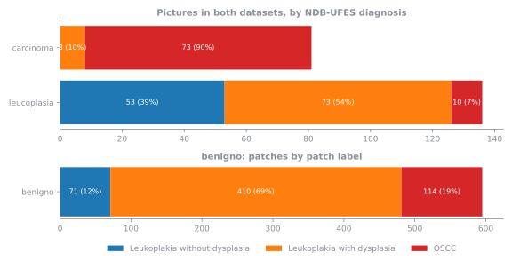
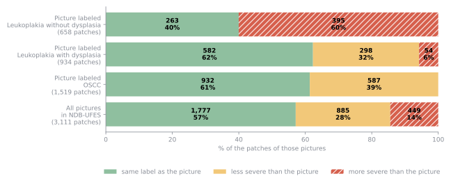
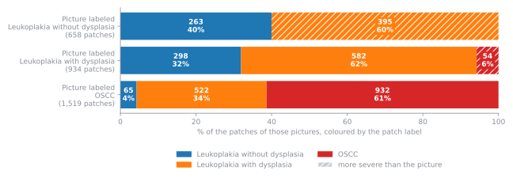
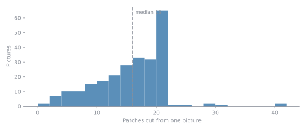
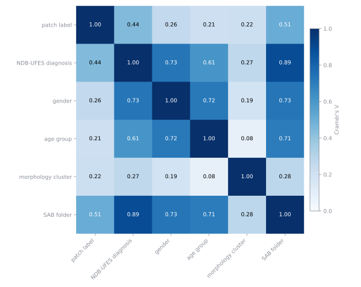

# Factsheet: P-NDB-UFES

The patch dataset and how its patches were tied to their parent pictures. Every number on this page comes from the published tables. How the four datasets differ is in [About the Data](about-the-data.md), the folds are in [New Folds](folds.md), and every column is in the [data dictionary](data-dictionary.md).

## At a glance

| Item | Count |
| --- | ---: |
| Patches (512 × 512 pixels) | 3,763 |
| Pictures | 288 |
| Pictures with patches | 247 |
| Pictures without patches | 41 |
| Patches per picture, median | 16 (1 to 40) |
| Diagnostic classes | 3 |
| Exact duplicate patches | 3 (one of each pair of twins) |

## Where the patches come from

The patches are the P-NDB-UFES patches. Their parent pictures come from two datasets: the public NDB-UFES origin images and the SAB images, which are not published. A picture can exist in one dataset or in both, and two files with identical pixels count as one picture.

| Found in | Pictures | Patches |
| --- | ---: | ---: |
| NDB-UFES and SAB | 217 | 3,111 |
| SAB only | 51 | 652 |
| NDB-UFES only | 20 | 0 |

## SAB folders against the NDB-UFES diagnosis

SAB files its images in three folders, `carcinoma`, `leucoplasia` and `benigno`. These are not the three NDB-UFES classes. For the 217 pictures that exist in both datasets:

| SAB folder | Pictures | Leukoplakia without dysplasia | Leukoplakia with dysplasia | OSCC |
| --- | ---: | ---: | ---: | ---: |
| carcinoma | 81 | 0 | 8 | 73 |
| leucoplasia | 136 | 53 | 73 | 10 |

`carcinoma` holds mostly OSCC but also pictures NDB-UFES diagnoses with dysplasia, and `leucoplasia` is a broad folder that holds all three diagnoses. None of the `benigno` pictures is in NDB-UFES, so they have no NDB-UFES diagnosis, but their patches are in P-NDB-UFES: its 46 pictures hold 595 patches (15.8% of all patches) labelled Leukoplakia with dysplasia (410), OSCC (114), Leukoplakia without dysplasia (71). The SAB folders come from the SAB database and were not re-validated one by one, which is why they are never used as classes.

## Classes

| Patch label | Patches | Percentage |
| --- | ---: | ---: |
| Leukoplakia without dysplasia | 707 | 18.8% |
| Leukoplakia with dysplasia | 1,930 | 51.3% |
| OSCC | 1,126 | 29.9% |

The patch label is the label models train on. The NDB-UFES diagnosis belongs to the whole picture:

| NDB-UFES diagnosis of the parent picture | Patches | Percentage |
| --- | ---: | ---: |
| Leukoplakia without dysplasia | 658 | 17.5% |
| Leukoplakia with dysplasia | 934 | 24.8% |
| OSCC | 1,519 | 40.4% |
| not in NDB-UFES | 652 | 17.3% |

A picture has many regions, so a patch can differ from its picture's label. No label was changed. The disagreement is recorded in `patch_vs_picture_diagnosis`. The first percentage is of all 3,763 patches; the second leaves out the 652 patches whose picture is not in NDB-UFES, which have no diagnosis to compare with.

| Patch against its picture | Patches | Percentage of all patches | Percentage of patches whose picture is in NDB-UFES |
| --- | ---: | ---: | ---: |
| match | 1,777 | 47.2% | 57.1% |
| patch_less_severe | 885 | 23.5% | 28.4% |
| patch_more_severe | 449 | 11.9% | 14.4% |
| not_in_ndb | 652 | 17.3% |  |

## Where the labels differ

Counting only the 3,111 patches whose picture is in NDB-UFES (the last column of the table above), the patch label equals the picture's diagnosis for 57.1% of them, is less severe for 28.4% and is more severe for 14.4%. The first chart shows these shares for the pictures of each diagnosis and for all of them together.

The second chart shows which labels the patches have, for the pictures of each diagnosis; the hatched parts are patches more severe than their picture.

- **Less severe patches** (885) are expected, because a picture has many regions. A picture labeled OSCC can still hold patches of leukoplakia: 522 (34.4%) with dysplasia and 65 (4.3%) without. Pictures labeled with dysplasia can still hold patches without dysplasia: 298 (31.9%).
- **More severe patches** (449, 11.9% of all patches) mean the picture's label is milder than part of its content.
    - Pictures labeled without dysplasia hold no OSCC patch. They do hold patches with dysplasia, 395 (60.0%): signs of dysplasia in pictures that were not labeled as having it.
    - Pictures labeled with dysplasia hold 54 (5.8%) OSCC patches. OSCC is the serious case, so these pictures need to be revalidated.

!!! note "The hardest classes"
    Leukoplakia with dysplasia and leukoplakia without dysplasia are the hardest classes to learn. The data shows why: 60% of the patches of the pictures judged as without dysplasia are labeled with dysplasia.

**Why they may differ.** The patches were labeled in a later step, not necessarily by the team that labeled NDB-UFES. The NDB-UFES diagnosis of the picture was accessible, but it was not used to label the patches, and the labeling was not blind. That may explain some of the patches with a more severe label.

## Patches per picture

| Pictures | Count | Mean | Median | First quartile | Third quartile | Smallest | Largest |
| --- | ---: | ---: | ---: | ---: | ---: | ---: | ---: |
| all pictures with patches | 247 | 15.2 | 16 | 12 | 20 | 1 | 40 |
| pictures in ndb+sab | 203 | 15.3 | 17 | 12 | 20 | 2 | 40 |
| pictures in sab | 44 | 14.8 | 15 | 10 | 19 | 1 | 29 |

The patch extractor kept at most 20 patches from an image file. 7 pictures have more, up to 40, because SAB holds two similar images of them, with identical pixels, and each gave its own patches.

## Related pictures

Some pictures show the same tissue: a wide view and a close-up, or two shots of one region. 92 pairs of pictures are tied by matching SIFT features, in 75 groups of related pictures that hold 160 of the 288 pictures (56%). In 83 of the 92 pairs (90%) the zoom differs, usually by about four times, so one picture is a close-up of a part of the other. This fits how the images were taken, with the 10x and 40x objectives: the two differ by a factor of four. [Matching and Atlases](matching-and-atlases.md) shows how they were found and has the atlas.

## How the patch variables relate

Each patch has its label, the diagnosis, gender and age group of its picture's patient, a morphology cluster (how the patch looks) and the SAB folder of its picture. The heatmap shows how strongly every two of them are tied, from 0 (not tied) to 1 (one decides the other); [how to read the heatmaps](factsheet-ndb-ufes.md#how-to-read-the-heatmaps). Pictures outside NDB-UFES have the value `unknown` for diagnosis, gender and age group, which ties those three together by construction.

The patch label and the morphology cluster are tied with V = 0.22: related, but a cluster is not a class. [New Folds](folds.md) shows the clusters by label.

## How each patch was tied to its picture

Every patch has a parent picture, checked in three independent ways:

| Check | Result |
| --- | ---: |
| Exact pixel match inside the parent picture | 3,763 of 3,763 exact |
| Template search over all 288 pictures names the picture in the SAB file name | 3,763 of 3,763 agree |
| SAB patch crop with the same pixels, file name and class | 3,763 of 3,763 verified |

1,237 patches (33%) also appear, confirmed by projection, in a related picture (a zoomed or shifted view of the same tissue). 6 patches have an exact twin, three pairs saved twice.

## Things to know

- **The `benigno` folder.** 46 pictures and 595 patches (15.8%) come from the SAB `benigno` folder. None of those pictures is in NDB-UFES, so they have no NDB-UFES diagnosis, but their patches are in P-NDB-UFES, with OSCC and dysplasia labels. They stay with their patch labels; `benigno` is never a class.
- **The patch label and the picture's diagnosis differ.** See [Where the labels differ](#where-the-labels-differ).
- **The SAB images are not published.** Publishing them would first need each image to be relabeled and verified, the way NDB-UFES was. Parts of them are shown in the atlases only because their patches are already published with labels, and the class shown for a SAB picture is not verified. Case prefixes and file paths are private as well; the published tables use pseudonyms.
