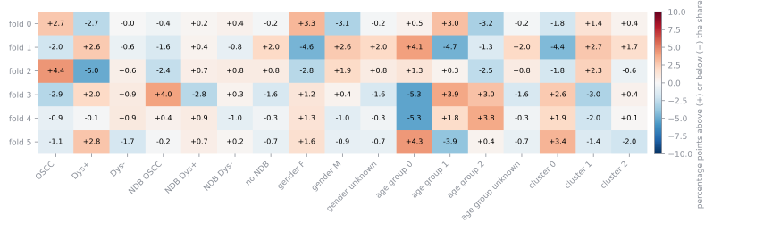
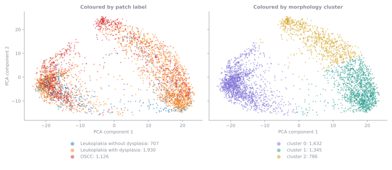
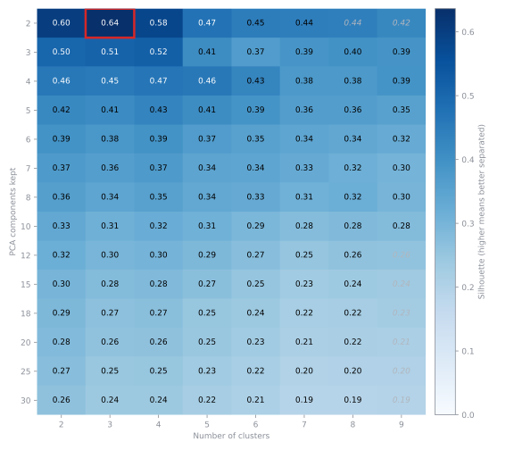
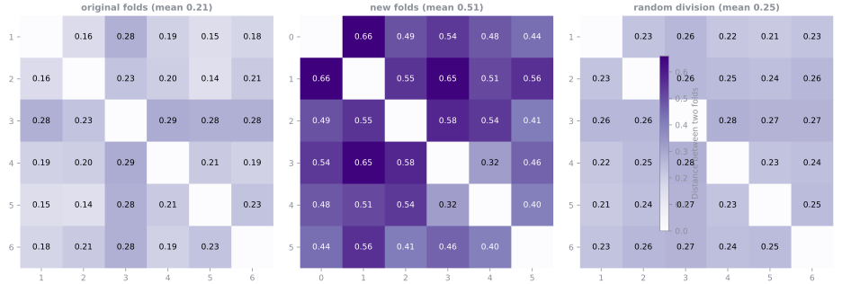

# New Folds

The folds of the rebuilt dataset. Every number on this page comes from the published tables.

## What they guarantee

- Every case group is in exactly one fold, so patches of the same patient are never on both sides of an evaluation. Neither is any parent picture, nor any group of related pictures.
- Every fold holds all three classes.
- The largest fold holds 1.084 times the patches of the smallest (the limit is 1.10).
- The same input always gives the same folds.

There is no separate test split: each of the six folds is held out in turn.

## Cases and case groups

The SAB file name carries a patient prefix, shown here as a masked case. Cases are tied into a case group when the same picture, related pictures, or one NDB-UFES patient appear under more than one prefix. 1 case group holds more than one case; every other group is one case. There are 64 cases in 63 case groups.

| Largest case groups | Patches |
| --- | ---: |
| group_002 | 200 |
| group_050 | 184 |
| group_061 | 177 |
| group_001 | 151 |
| group_019 | 129 |

## How they were made

The unit of assignment is the case group, so everything from one patient stays together. That alone does not make good folds, because case groups differ a lot in size and in what they hold: some are one picture, one is 200 patches. So each fold was also balanced on other information about the patches, all with equal weight:

- the patch label,
- the NDB-UFES diagnosis of the picture (`unknown` for pictures outside NDB-UFES),
- the gender and the age group of the NDB-UFES patient (`unknown` for pictures outside NDB-UFES),
- the morphology cluster of the patch, which is how the patch looks (see below).

A greedy algorithm does the dividing. The case groups are dealt out largest first, and each goes to the fold where it keeps all those counts closest to an equal share. A greedy choice is the best one at that step, and it is never revisited, so the result is then improved: single groups are moved, and pairs of groups exchanged between two folds, for as long as that lowers the total deviation from an equal share. The whole search is repeated from 201 starting points (one greedy, 200 shuffled with a fixed seed) and the best result is kept. The 3,760 patches counted are those left after the three duplicate pairs are counted once.

## The folds in numbers

Each table is one variable. Counts are patches, followed by their percentage of the fold. The last row, `spread`, is the percentage of the fold with the highest share minus that of the fold with the lowest, in percentage points: for the OSCC column, the fold with the most OSCC patches has that many points more of them than the fold with the fewest. Small numbers mean the folds look alike.

### Size

| Fold | Case groups | Patches |
| --- | ---: | ---: |
| fold 0 | 12 | 625 |
| fold 1 | 8 | 641 |
| fold 2 | 11 | 605 |
| fold 3 | 12 | 628 |
| fold 4 | 10 | 605 |
| fold 5 | 10 | 656 |
| all folds | 63 | 3,760 |

Only the patches are balanced, not the number of case groups: groups differ a lot in size, so a fold can hold fewer groups and still be as large.

### Patch label

| Fold | OSCC | Leukoplakia with dysplasia | Leukoplakia without dysplasia |
| --- | ---: | ---: | ---: |
| fold 0 | 204 (33%) | 304 (49%) | 117 (19%) |
| fold 1 | 179 (28%) | 346 (54%) | 116 (18%) |
| fold 2 | 208 (34%) | 280 (46%) | 117 (19%) |
| fold 3 | 170 (27%) | 335 (53%) | 123 (20%) |
| fold 4 | 176 (29%) | 310 (51%) | 119 (20%) |
| fold 5 | 189 (29%) | 355 (54%) | 112 (17%) |
| all folds | 1,126 (30%) | 1,930 (51%) | 704 (19%) |
| spread | 7.3 points | 7.8 points | 2.6 points |

### NDB-UFES diagnosis of the picture

| Fold | OSCC | Leukoplakia with dysplasia | Leukoplakia without dysplasia | Not in NDB-UFES |
| --- | ---: | ---: | ---: | ---: |
| fold 0 | 250 (40%) | 156 (25%) | 112 (18%) | 107 (17%) |
| fold 1 | 249 (39%) | 161 (25%) | 107 (17%) | 124 (19%) |
| fold 2 | 230 (38%) | 154 (25%) | 111 (18%) | 110 (18%) |
| fold 3 | 279 (44%) | 138 (22%) | 112 (18%) | 99 (16%) |
| fold 4 | 247 (41%) | 155 (26%) | 100 (17%) | 103 (17%) |
| fold 5 | 264 (40%) | 167 (25%) | 116 (18%) | 109 (17%) |
| all folds | 1,519 (40%) | 931 (25%) | 658 (18%) | 652 (17%) |
| spread | 6.4 points | 3.6 points | 1.8 points | 3.6 points |

### Gender of the NDB-UFES patient

`Unknown` is a picture that is not in NDB-UFES.

| Fold | Female | Male | Unknown |
| --- | ---: | ---: | ---: |
| fold 0 | 226 (36%) | 292 (47%) | 107 (17%) |
| fold 1 | 181 (28%) | 336 (52%) | 124 (19%) |
| fold 2 | 182 (30%) | 313 (52%) | 110 (18%) |
| fold 3 | 214 (34%) | 315 (50%) | 99 (16%) |
| fold 4 | 207 (34%) | 295 (49%) | 103 (17%) |
| fold 5 | 226 (34%) | 321 (49%) | 109 (17%) |
| all folds | 1,236 (33%) | 1,872 (50%) | 652 (17%) |
| spread | 7.9 points | 5.7 points | 3.6 points |

### Age group of the NDB-UFES patient

| Fold | Group 0, < 40 years | Group 1, 40-60 years | Group 2, > 60 years | Unknown |
| --- | ---: | ---: | ---: | ---: |
| fold 0 | 36 (6%) | 251 (40%) | 231 (37%) | 107 (17%) |
| fold 1 | 60 (9%) | 208 (32%) | 249 (39%) | 124 (19%) |
| fold 2 | 40 (7%) | 227 (38%) | 228 (38%) | 110 (18%) |
| fold 3 | 0 (0%) | 258 (41%) | 271 (43%) | 99 (16%) |
| fold 4 | 0 (0%) | 236 (39%) | 266 (44%) | 103 (17%) |
| fold 5 | 63 (10%) | 218 (33%) | 266 (41%) | 109 (17%) |
| all folds | 199 (5%) | 1,398 (37%) | 1,511 (40%) | 652 (17%) |
| spread | 9.6 points | 8.6 points | 7.0 points | 3.6 points |

Age group 0 is only 199 patches in a few case groups, so two folds hold none of it.

### Morphology cluster

| Fold | Cluster 0 | Cluster 1 | Cluster 2 |
| --- | ---: | ---: | ---: |
| fold 0 | 260 (42%) | 232 (37%) | 133 (21%) |
| fold 1 | 250 (39%) | 246 (38%) | 145 (23%) |
| fold 2 | 252 (42%) | 230 (38%) | 123 (20%) |
| fold 3 | 289 (46%) | 205 (33%) | 134 (21%) |
| fold 4 | 274 (45%) | 204 (34%) | 127 (21%) |
| fold 5 | 307 (47%) | 225 (34%) | 124 (19%) |
| all folds | 1,632 (43%) | 1,342 (36%) | 786 (21%) |
| spread | 7.8 points | 5.7 points | 3.7 points |

### SAB `benigno` folder

This count is reported but not balanced.

| Fold | Patches from the benigno folder |
| --- | ---: |
| fold 0 | 107 (17%) |
| fold 1 | 68 (11%) |
| fold 2 | 110 (18%) |
| fold 3 | 98 (16%) |
| fold 4 | 103 (17%) |
| fold 5 | 109 (17%) |
| all folds | 595 (16%) |
| spread | 7.6 points |

## How even they are

The chart shows, for every value in every fold, how many percentage points its share is above (red) or below (blue) its share in all the folds. For example, +4.5 in the OSCC column means 4.5 points more of the fold's patches are OSCC than of all patches. The largest gap is -5.3 points, for age group 0 in fold 3. [Old Folds and Contamination](old-folds.md) sets this against the original folds.

## Morphology clusters

Patches of different pictures can look alike, and a fold made mostly of one kind of appearance would test something different from the other folds. So the folds are balanced on how the patches look as well. Each patch is turned into a list of numbers (an embedding) by the Virchow pathology model. Reduced to the two directions that vary most (the first two PCA components), the patches form the picture below, where each dot is a patch. The same patches are coloured by patch label on the left and by cluster on the right. The clusters describe appearance, not diagnosis: every class spreads over several of them.

The patches are grouped into 3 clusters with K-Means (seed 42). The number of PCA components and of clusters was chosen by how well separated the clusters are (the silhouette, higher is better), among the choices whose clusters were not too small or too uneven. The chart shows every choice tried; the red square is the one used (silhouette 0.64), and numbers in grey italics are choices that were set aside for their cluster sizes.

| Cluster | Patches | Leukoplakia without dysplasia | Leukoplakia with dysplasia | OSCC |
| --- | ---: | ---: | ---: | ---: |
| cluster 0 | 1,632 | 437 (27%) | 648 (40%) | 547 (34%) |
| cluster 1 | 1,345 | 214 (16%) | 899 (67%) | 232 (17%) |
| cluster 2 | 786 | 56 (7%) | 383 (49%) | 347 (44%) |

## Distance between the folds

The chart gives, for every two folds, how far apart they are in the plane of the first two PCA components of the patch embeddings (the picture under [Morphology clusters](folds.md#morphology-clusters)). The distance is 0 when two folds cover the space in exactly the same way and grows the more differently they cover it. The panels are the original folds, the new folds, and a random division of the patches into six folds of the same sizes as the new folds (the average of 20 divisions), which is the distance that chance alone gives. The number in each title is the mean distance.

The original folds are about as close as a random division (mean 0.21 against 0.25), because they deal the patches out one by one. The new folds are about 2.1 times as far apart (mean 0.51), and the farthest are folds 0 and 1 (0.66). Patches of one case group look alike and sit close together, so keeping case groups in one fold makes each fold cover the space a little differently.

## Using the folds

Use `results/phase1/folds/fold_assignments.csv` and its `fold` column instead of a random patch-level split. Skip the three patches with an empty `fold`: they are exact duplicates of a patch that stays in the folds. The label to predict is `patch_diagnosis`. To rebuild everything, see [Reproducibility](reproducibility.md).
