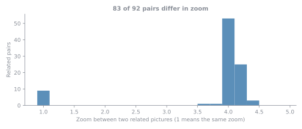

# Matching and Atlases

How patches and pictures were tied together, and the two PDF atlases that show it.

## Two kinds of matching

The datasets hold the same material in several forms, so two questions had to be answered: which picture was each patch cut from, and which pictures show the same tissue.

- **Template matching, patch to picture.** A patch is a straight crop of its picture, so its size and colors do not change. The patch is slid over the picture and the position where the pixels are identical is the answer. All 3,763 patches were found this way, exactly, in a picture of NDB-UFES or SAB.
- **SIFT, picture to picture.** Pictures of the same tissue vary in zoom, color and rotation, so exact pixels cannot be used. SIFT finds distinctive points in both pictures, the matching points are checked for one consistent geometry, and a pair counts as related when enough points agree.

## What it found

- 92 pairs of pictures are tied strongly, in 75 groups of related pictures that hold 160 of the 288 pictures (56%).
- In 83 of the 92 pairs (90%) one picture is a zoomed close-up of part of the other, usually about four times. This fits the 10x and 40x objectives the images were taken with, which differ by a factor of four.
- 1,237 patches (33%) also appear in a second picture. Their position there was found by carrying the patch through the geometry between the two pictures.
- The file names of SAB point to the same pictures: all 3,763 agree (100%). See [About the Data](about-the-data.md).

## The atlases

Both are PDFs, made so that the links can be checked by eye.

- [Patient atlas](https://github.com/beamaia/ndb_ufes_data_organizer/raw/main/atlases/patient_atlas.pdf) (19 MB). One page for each case group: its pictures with a box around each patch, and below them each patch next to the region cut from the picture at those coordinates. The two sides are the same pixels, one the original patch file and the other the crop, so a mismatch would be visible at once.
- [Aligned atlas](https://github.com/beamaia/ndb_ufes_data_organizer/raw/main/atlases/aligned_atlas.pdf) (8 MB). One row for each pair of related pictures. At the same zoom the two pictures are shown as one picture plus another picture equals the joined picture. When one is a close-up, the wide picture is shown with the rotated close-up outlined in it and the share of the close-up that lies inside the wide picture.

!!! warning "About the SAB pictures in the atlases"
    The SAB images are not published and are not available to download. Publishing them would first need each image to be relabeled and verified, the way NDB-UFES was. They appear in the atlases because their patches are already published with labels, and because part of the same tissue is already public in the dataset. The class shown for a SAB-only picture is the one the SAB database gave it, and it has not been verified. The atlases are for checking the links, not a copy of the images.
