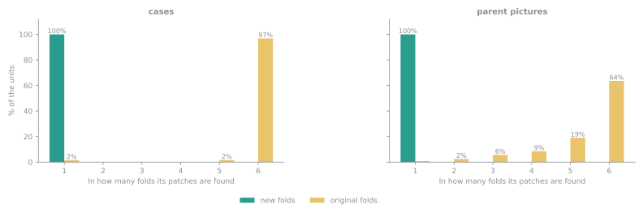
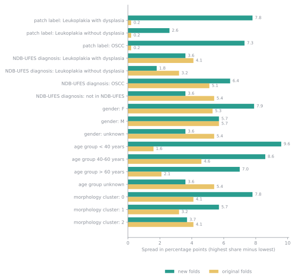

# Old Folds and Contamination

The folds published with P-NDB-UFES on Mendeley Data, measured against the links rebuilt here and set beside the [new folds](folds.md). They are six folds of about 627 patches each, in six folders. Every number on this page comes from the published tables.

## Contamination

Folds are contaminated when the same patient, picture or case has patches in more than one of them: whichever fold is held out, part of that unit is in the training folds. The links between patches, pictures and cases were not available when the original folds were made, so this is measured against the links rebuilt here. The table counts the units that have patches in more than one fold.

| Unit | Units | Split in the original folds | Split in the new folds |
| --- | ---: | ---: | ---: |
| cases | 64 | 63 (98%) | 0 (0%) |
| case groups | 63 | 62 (98%) | 0 (0%) |
| parent pictures | 247 | 245 (99%) | 0 (0%) |
| groups of related pictures | 173 | 172 (99%) | 0 (0%) |

3,762 of the 3,763 patches (99.97%) belong to a case that the original folds split. The chart shows, for cases and for pictures, in how many folds their patches are found. In the original folds nearly every case is spread over all six; in the new folds every case, and every picture, is in one.

## Neighbouring patches

Patches of one picture can overlap, because they were cut next to each other. Two overlapping patches in different folds share tissue between a training fold and a test fold. The table counts the pairs of patches of one picture that share at least the given part of their area, and how many of them are in different folds.

| Shared area | Pairs | In different folds, original folds | In different folds, new folds |
| --- | ---: | ---: | ---: |
| at least 25% | 7,119 | 5,963 (84%) | 0 (0%) |
| at least 50% | 3,149 | 2,621 (83%) | 0 (0%) |
| at least 75% | 762 | 641 (84%) | 0 (0%) |

An example from the data: `p0020` and `p0021` are cut from one picture, at (240, 719) and (486, 974), and share about 26% of their area. In the original folds they are in folders 5 and 3, so a model trained on one is tested on a neighbour that holds part of the same tissue. In the new folds they are in folds 0 and 0.

## Balance

Contamination is one side. The other is whether the folds look alike. For each value, the table gives the spread: the percentage of the fold with the highest share of that value minus the percentage of the fold with the lowest, in percentage points. For example, if 30% of the patches of one fold are OSCC and 25% of another fold's, the spread is 5 points. Small numbers mean the folds look alike.

| Value | Spread, original folds | Spread, new folds |
| --- | ---: | ---: |
| patch label: Leukoplakia with dysplasia | 0.2 | 7.8 |
| patch label: Leukoplakia without dysplasia | 0.2 | 2.6 |
| patch label: OSCC | 0.2 | 7.3 |
| NDB-UFES diagnosis: Leukoplakia with dysplasia | 4.1 | 3.6 |
| NDB-UFES diagnosis: Leukoplakia without dysplasia | 3.2 | 1.8 |
| NDB-UFES diagnosis: OSCC | 5.1 | 6.4 |
| NDB-UFES diagnosis: not in NDB-UFES | 5.4 | 3.6 |
| gender: F | 5.3 | 7.9 |
| gender: M | 5.7 | 5.7 |
| gender: unknown | 5.4 | 3.6 |
| age group unknown | 5.4 | 3.6 |
| age group < 40 years | 1.6 | 9.6 |
| age group 40-60 years | 4.6 | 8.6 |
| age group > 60 years | 2.1 | 7.0 |
| morphology cluster: 0 | 4.1 | 7.8 |
| morphology cluster: 1 | 3.2 | 5.7 |
| morphology cluster: 2 | 4.1 | 3.7 |

The original folds are the more even: their widest spread is 5.7 points, against 9.6 for the new folds. The new folds give up a little evenness to keep every case, picture and group of related pictures in one fold. The widest spreads in the new folds are for the smallest groups of patients, for example age group 0, which is only 199 patches in a few case groups.

## The original folds and the morphology clusters

The original folds deal patches out one by one, so patches of one picture end up in different folders. How the folders divide the three morphology clusters (see [New Folds](folds.md#morphology-clusters) for what they are):

| Folder | Cluster 0 | Cluster 1 | Cluster 2 |
| --- | ---: | ---: | ---: |
| folder 1 | 281 (45%) | 224 (36%) | 123 (20%) |
| folder 2 | 271 (43%) | 230 (37%) | 126 (20%) |
| folder 3 | 255 (41%) | 228 (36%) | 144 (23%) |
| folder 4 | 274 (44%) | 213 (34%) | 140 (22%) |
| folder 5 | 276 (44%) | 233 (37%) | 118 (19%) |
| folder 6 | 275 (44%) | 217 (35%) | 135 (22%) |
| all folders | 1,632 (43%) | 1,345 (36%) | 786 (21%) |

## Distance between the folds

The chart gives, for every two folds, how far apart they are in the plane of the first two PCA components of the patch embeddings (the picture under [Morphology clusters](folds.md#morphology-clusters)). The distance is 0 when two folds cover the space in exactly the same way and grows the more differently they cover it. The panels are the original folds, the new folds, and a random division of the patches into six folds of the same sizes as the new folds (the average of 20 divisions), which is the distance that chance alone gives. The number in each title is the mean distance.

The original folds are about as close as a random division (mean 0.21 against 0.25), because they deal the patches out one by one. The new folds are about 2.1 times as far apart (mean 0.51), and the farthest are folds 0 and 1 (0.66). Patches of one case group look alike and sit close together, so keeping case groups in one fold makes each fold cover the space a little differently.

## What this means

Results on the original folds are not directly comparable with results on the new folds, and scores on the original folds can be higher than they would be on new patients, because their test folds hold neighbours of their training patches. Retraining on the new folds is what will show how much the contamination mattered.
